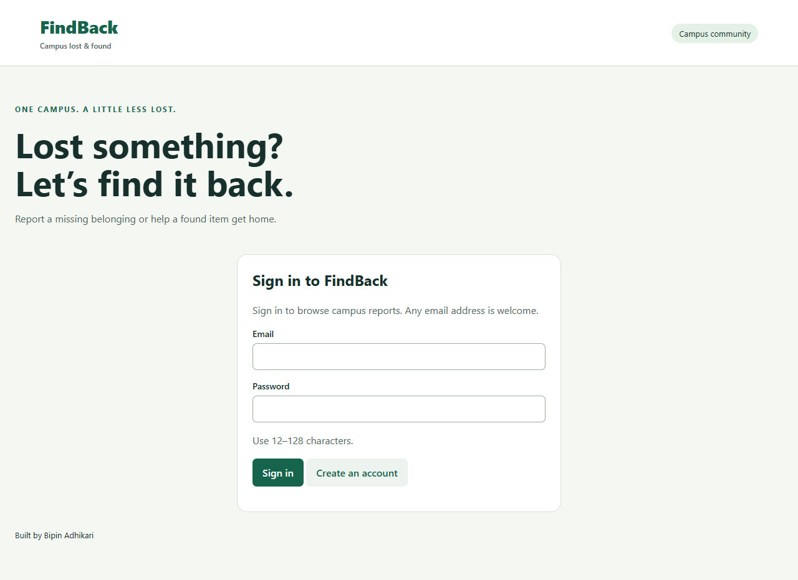
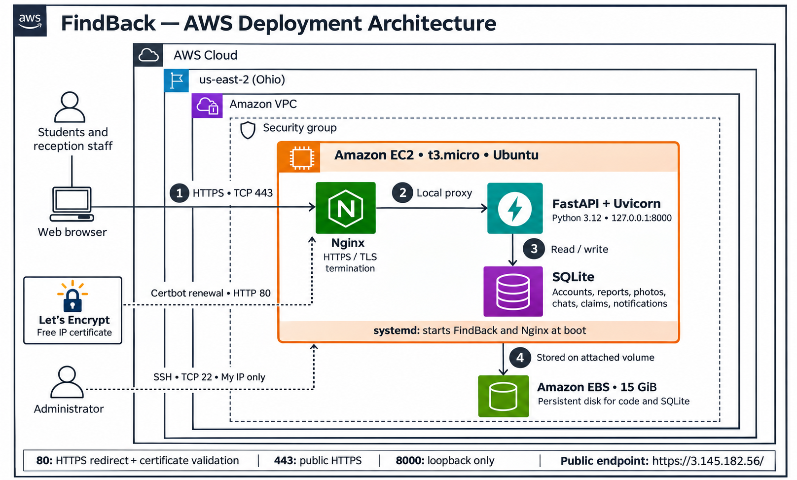

# FindBack

Campus lost-and-found application built with FastAPI, SQLite, HTML, CSS, and JavaScript, deployed on AWS EC2 with Nginx and HTTPS.

**Bipin Adhikari** · bxa3266@mavs.uta.edu

## Features

- Any-email registration, password sign-in, and persistent sessions.
- Protected lost/found reports across 48 categories, including Other.
- Up to three photos per report, separate found and pickup locations.
- Private item conversations, claims, finder decisions, and confirmed returns.
- Reception-held items and administrator-managed reception access.
- Rule-based possible matches and persistent in-app notifications.
- Complete database backup script and isolated workflow tests.



## Run locally

The deployment uses Python 3.12. No AWS account is needed locally.

Windows PowerShell:

```powershell
py -3.12 -m venv .venv
.\.venv\Scripts\python.exe -m pip install -r requirements.txt
.\.venv\Scripts\python.exe run.py
```

Linux/macOS:

```sh
python3.12 -m venv .venv
source .venv/bin/activate
python -m pip install -r requirements.txt
python run.py
```

Open http://127.0.0.1:8000. API documentation is at `/docs`. Use `python run.py --port 8002` if needed. Startup creates `data/findback.sqlite3`. This repository contains no real accounts or database.

Register through the website. To promote an existing account using the same database as the server:

```sh
python scripts/set_admin.py YOUR_REGISTERED_EMAIL
```

Refresh the website to see reception management. Regular users post finder-held items. Reception/admin accounts may post reception-held items. The staff account that posts the report handles its messages and collection.

## AWS deployment



The final deployment uses EC2 (Ubuntu t3.micro in us-east-2), a 15 GiB EBS disk, VPC networking, and security groups. Nginx handles HTTPS and proxies to FastAPI on `127.0.0.1:8000`. SQLite stores records and photos on EBS. systemd manages services, and Certbot renews the Let's Encrypt IP certificate.

S3, RDS, Cognito, Lambda, and a load balancer are not deployed. The diagram is illustrative: security groups filter EC2 network traffic, not EBS disk operations.

Demo address at deployment: https://3.145.182.56/. Availability depends on the instance, current IP, and certificate. This is not a permanent hosting guarantee.

## Tests

With the virtual environment active:

```sh
python scripts/verify.py
python scripts/test_chat.py
python scripts/test_claims.py
python scripts/test_matching.py
python scripts/test_activity.py
python scripts/test_database_backup.py
python scripts/test_cloud_backup.py
```

Tests use temporary databases. The legacy cloud-backup test uses a mock storage client and makes no AWS calls.

## Backups

```sh
python scripts/backup_database.py /private/backup/location/findback.sqlite3
```

Use a new destination. Full snapshots contain private account and application data: keep them outside Git and the public web directory. `cloud_backup.py` is an optional reports-only prototype export, not the deployed backup process or a full database backup. Optional SDK dependencies are in `requirements-cloud.txt`.

## Known limitations

- Matching uses rules, not machine learning. Suggestions do not prove ownership and require reports from different users.
- Returning a found item does not close the separate lost report. There is no owner-facing recovered action yet.
- No email verification, password recovery, shared reception inbox, or report ownership transfer.
- One claim per user per item; rejected and withdrawn claims are terminal.
- Single server and local backups; no high availability or measured load capacity.

## Documentation

- [Architecture](docs/architecture.md)
- [Deployment](docs/deployment.md)
- [API](docs/api.md)
- [Verification](docs/verification.md)
- [Project status](docs/progress.md)
