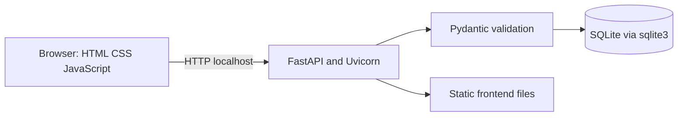
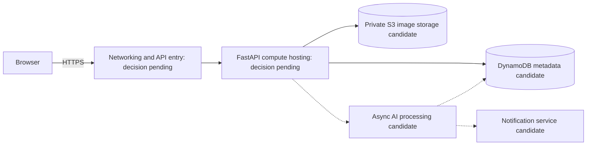

# Architecture

## Implemented local architecture

One process serves the frontend and API at the same origin. Startup creates the reports table; requests use separate connections and parameterized SQL. SQLite stores reports on disk outside Git. No cloud service is involved. Health checks test process response only.

## Proposed AWS architecture — not deployed

Compute must host FastAPI; validate managed-container or other hosting options against course requirements and costs. Networking must provide HTTPS, routing, and access controls; API gateway/load balancer choice remains open. DynamoDB requires access-pattern/index design and replacement of SQLite queries. S3 would hold private photos with validated uploads and scoped access. Semantic matching could process reports asynchronously. AI processing and notifications are unimplemented design candidates. Authentication, IAM, logging, secret handling, budget limits, and backups require design before deployment. The instructor-provided AWS Academy Learner Lab is the intended account; lab access, service permissions, and budget must be confirmed before deployment. No paid resources have been created for this prototype.
