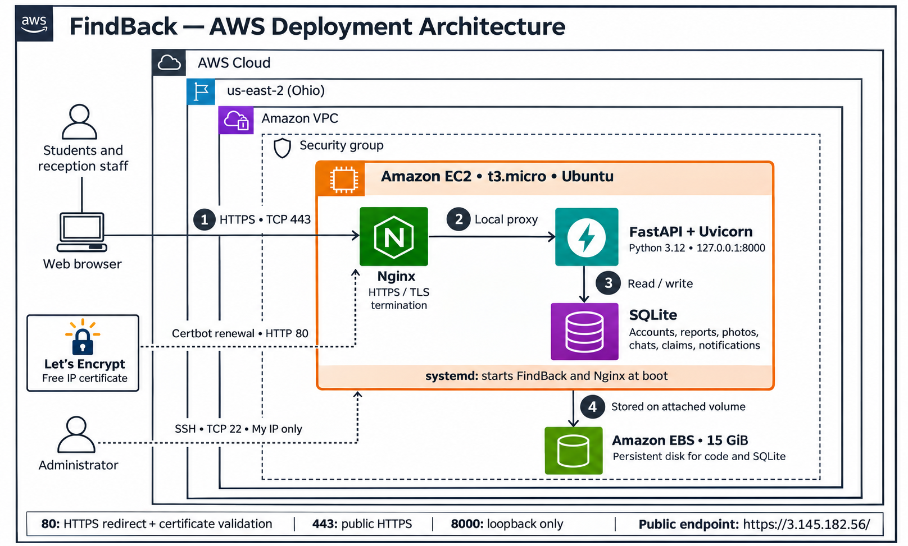

# Architecture

The browser connects over HTTPS to Nginx. Nginx forwards requests to FastAPI/Uvicorn on loopback port 8000 on the same EC2 instance. FastAPI checks authentication, ownership, roles, and input before accessing SQLite. Frontend and API share one origin.

SQLite stores accounts, hashed sessions, reports, photo blobs, conversations, messages, claims, claim history, matches, and notifications. The database file resides on attached EBS storage. EBS is not a separate database server. Security groups protect the EC2 network interface, not EBS I/O.

systemd starts services at boot. Certbot renews the IP certificate and reloads Nginx. HTTP port 80 supports validation and redirects browsers to HTTPS. Port 443 is public; SSH is restricted to the administrator's IP. Port 8000 stays private to the server.

A single EC2 instance and SQLite keep the class deployment manageable. A managed database, shared photo storage, multiple application servers, and a load balancer were deferred. S3 is a future option for photos and off-instance backups.

Matching runs during report creation and startup backfill. Chats and notifications poll while visible. Larger datasets would benefit from background matching and performance testing.
